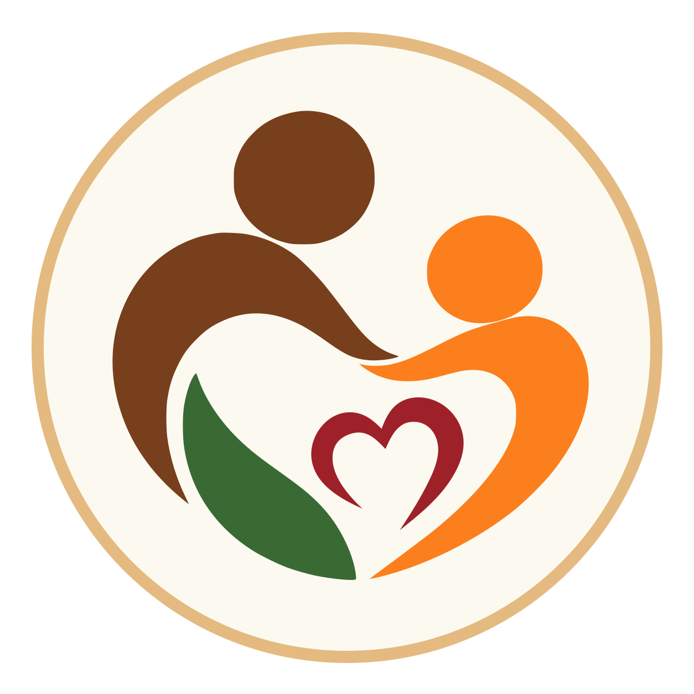

  

<h1 align="center">Gambasse</h1>

  
  
  
  
  
  
  

  <strong>English</strong> | <a href="README_es.md">Español</a>

  Gambasse is a clinical-record and consultation application for NGOs or any health professional
  working with patients in remote, humble areas where there is no population census
  and people lack identity documents. Since there is no official ID to locate a
  patient, the app records who each patient lives with so they can be traced and
  found later, and the medical history also captures social context such as whether
  they live with domestic animals or have treated running water, as well as birth
  dates when known — in many cases there are no birth certificates and people do not
  know when, or even if, they were born. Built in <strong>C++</strong> with
  <strong>Qt Quick (QML)</strong> for the UI and <strong>SQLite</strong> for storage, a
  choice that lets it run on less powerful computers while keeping excellent
  performance.

---

## Built for everyday clinical work

Gambasse brings patient registration, clinical histories, and consultation notes together in a calm, responsive desktop program designed for doctors, nurses, and community health teams.

### Registering and finding patients without official IDs

- **Context that helps you find people again:** record each patient's name, sex, birth date (when known) or approximate age, address, **cohabitants** (who they live with), a **contact person**, and number of siblings.
- **Patient photos:** attach a photo to help confirm identity at future visits. Photos taken on mobile phones are automatically rotated to the right orientation.
- **Fast search and sorting:** type in the filter box above any column to narrow down the patient list immediately, or click any column header to sort alphabetically, by code, or by age.
- **Duplicate protection:** warns you if a patient with the same name, sex, birth date, and age is already registered, helping keep clinic records accurate.

### Clinical histories tailored to each patient

Gambasse automatically offers the clinical histories suited to each patient's age and sex:

- **Pediatric history** *(up to age 16)*: allergies, birth weight and height, delivery incidents, child health history, housing and sanitation conditions, feeding habits, previous treatments, and vaccination records.
- **Adult history** *(over age 16)*: allergies, chronic conditions (such as diabetes, hepatitis, or HIV and their treatments), occupation, family and social context, housing conditions (potable water, mosquito net use, latrine, domestic animals), and baseline vital signs.
- **Pregnancy history** *(female patients aged 9 and older)*: allergies, obstetric and medical history, housing conditions, physical examination (uterine height, urine checks, edemas), and previous and current supplements or treatments.

### Consultations and visit follow-up

Once a patient has a clinical history, you can record **Pediatric**, **Adult**, or **Pregnancy** consultations and review earlier visits in chronological order from the same window:

- Depending on the consultation type, document the reason for the consultation, nursing diagnosis, system-by-system physical examination findings, treatments, and child care recommendations.
- In adult consultations, use a numbered body diagram to record the region and description of body lesions.

### Comfortable for your team

- **Three languages built in:** switch live from the title bar between **Portuguese** (Guinea-Bissau / European Portuguese norm), **Spanish**, and **English**. The calendar (weeks starting on Monday, `dd/MM/yyyy` dates) and patient sorting follow your chosen language automatically.
- **Light and dark themes:** switch between light mode for bright consultation rooms and dark mode for low-light settings.
- **Adjustable zoom in clinical forms:** enlarge history and consultation windows up to twice their size using the magnifying-glass buttons in the window title bar—or `Ctrl` + `+`, `Ctrl` + `-`, and `Ctrl` + `0` to reset—for easier reading without ever overflowing your screen.
- **Consistent, clear text:** includes its own typeface so forms look crisp and readable on every computer, and remembers your preferred language, theme, and reading size between sessions.

## Offline, portable, and easy to back up

- **No internet or server required:** all clinic records stay on the computer you are using, so Gambasse works reliably in areas without connectivity.
- **No installation needed:** runs directly on **Windows** (Windows 10 or later) and **64-bit Linux** without administrator rights.
- **Simple backups:** patient data, clinical histories, consultations, and photos are stored together right alongside the application (`database.db` and the `fotos/` folder). To make a backup or move your clinic's records to another computer, copy the entire folder.
- **Smooth upgrades:** if you already have records from an earlier version of Gambasse, your existing data and photos are preserved and updated automatically the first time you open the new version.
- **Version and notices:** open **Help → About** in the title bar at any time to check the installed version and open-source notices.

## For developers

Interested in building Gambasse from source, contributing, or packaging it for Linux and Windows? Technical documentation—covering branching and versioning, configuration and database migrations, toolchain requirements, Linux/Windows/static builds, QML workflow, diagnostics, and internationalization—is available in the [Developer Documentation](docs/README-DEVELOPER.md).

## License

Released under the **MIT License**. You are free to use, modify, and distribute
this software, including in proprietary projects, provided you retain the
original copyright notice. See [LICENSE.md](LICENSE.md) for details.

Qt is used under the LGPL v3. The self-contained Linux and Windows executables
link it statically: anyone who receives them must be able to link them again
against another Qt, which the public sources of this project and its build
scripts allow. A distributed self-contained executable must come with the text
of the LGPL and Qt's notices.

The interface font, Noto Sans (Regular and Bold, unmodified), is embedded in the
executables under the SIL Open Font License 1.1, which the MIT License does not
replace. Its notices and licence are in `resources/fonts/OFL.txt`, and the About
dialog of the Help menu shows them.
